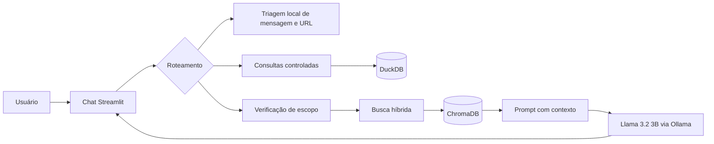

# Guardião Anti-Golpes Digitais

O Guardião é um assistente local que reúne orientação documental, consultas
estatísticas e triagem explicável de mensagens e URLs relacionadas a golpes
digitais.

## Objetivo

Ajudar pessoas a reconhecer sinais que merecem verificação, consultar ações
preventivas fundamentadas em documentos confiáveis e explorar padrões de um
conjunto estruturado de URLs. A aplicação comunica incertezas e não acessa os
endereços informados pelo usuário.

## Declaração do desafio

A motivação, a pergunta essencial e o desafio que orientaram o projeto estão
registrados na [Declaração CBL](docs/DECLARACAO_CBL.md).

## Funcionalidades

- Chat em Streamlit com respostas progressivas e histórico da sessão.
- LLM local `llama3.2:3b`, executado pela API do Ollama.
- RAG com três cartilhas do CERT.br, 44 chunks e índice ChromaDB.
- Exibição de documento, página, chunk, distância vetorial e uso da fonte.
- Duas consultas em linguagem natural a tabelas relacionadas no DuckDB.
- Triagem local de mensagens e URLs, sem abrir os endereços.
- Recusa de perguntas fora do escopo documental.

## Arquitetura



O roteamento é determinístico. As perguntas estatísticas são associadas a SQLs
previamente aprovados; o modelo não recebe permissão para gerar ou executar SQL
arbitrário. No RAG, a busca vetorial é combinada com termos da pergunta e apenas
os trechos suficientemente relevantes são enviados ao modelo.

## Pré-requisitos

- Windows com PowerShell.
- Python 3.11.
- [Ollama](https://ollama.com/) instalado e em execução.
- Conexão com a internet durante a primeira preparação do modelo de embeddings.

## Instalação

Clone o repositório e entre na pasta do projeto:

```powershell
git clone https://github.com/pedromanuelvincit/guardiao-anti-golpes.git
Set-Location guardiao-anti-golpes
```

Crie o ambiente e instale as dependências:

```powershell
py -3.11 -m venv .venv
& ".\.venv\Scripts\python.exe" -m pip install -r requirements.txt
ollama pull llama3.2:3b
```

Os valores padrão de configuração estão documentados em `.env.example`. Como
o projeto funciona sem chaves externas, nenhuma credencial precisa ser criada.

## Preparação dos componentes

### 1. DuckDB

Os dois CSVs processados ficam em `data/processed` e se relacionam pela chave
`url_id`. Crie o banco local com:

```powershell
& ".\.venv\Scripts\python.exe" ".\scripts\build_duckdb.py"
```

O script cria `data/guardiao.duckdb`, valida a relação um para um e informa as
quantidades carregadas.

Para reproduzir também os CSVs, baixe o ZIP do dataset
[PhiUSIIL Phishing URL](https://archive.ics.uci.edu/dataset/967/phiusiil%2Bphishing%2Burl%2Bwebsite%2Bdataset)
para `data/raw/phiusiil.zip` e execute:

```powershell
& ".\.venv\Scripts\python.exe" ".\scripts\prepare_phiusiil.py" --input ".\data\raw\phiusiil.zip" --output-dir ".\data\processed"
& ".\.venv\Scripts\python.exe" ".\scripts\build_duckdb.py"
```

O preparo não visita as URLs do conjunto. Ele usa apenas o texto dos endereços,
remove duplicatas, redige valores de query e fragmento e neutraliza os campos
exibíveis.

### 2. ChromaDB

As três cartilhas ficam em `data/documents/raw`. Gere novamente os chunks e o
índice vetorial com:

```powershell
& ".\.venv\Scripts\python.exe" ".\scripts\prepare_rag.py"
```

Na primeira execução, a biblioteca baixa o modelo multilíngue de embeddings. O
aviso do Windows sobre suporte a links simbólicos não impede a indexação.

### 3. Classificador de risco (Sprint 1)

Treine e avalie o classificador local sem abrir nenhuma URL. Para persistir o
vencedor da validação, informe explicitamente um caminho de saída:

```powershell
& ".\.venv\Scripts\python.exe" ".\scripts\train_model.py" --model-output ".\data\models\url_risk_model.joblib"
```

O arquivo salvo contém o modelo escolhido, as 25 colunas numéricas esperadas
e o adaptador de entrada. O treinamento também compara limites de decisão na
validação, sem usar o teste para escolher o limite. A aplicação carrega esse
arquivo automaticamente;
para usar outro caminho, defina `GUARDIAO_MODEL_PATH`. O carregador apenas
analisa o texto da URL e não abre o endereço.

## Execução

Mantenha o Ollama aberto e inicie a interface:

```powershell
& ".\.venv\Scripts\python.exe" -m streamlit run ".\app.py"
```

O Streamlit exibirá o endereço local da aplicação no terminal.

## Perguntas para demonstração

### RAG documental

1. `Como conferir se um boleto é verdadeiro antes de pagar?`
2. `Como verificar se um áudio ou vídeo de alguém conhecido pode ter sido falsificado com inteligência artificial?`
3. `O que devo fazer depois de transferir dinheiro por Pix para um golpista?`

### Dados estruturados

1. `Quantas URLs são phishing e quantas são legítimas?`
2. `Qual é o comprimento médio das URLs e qual percentual usa HTTPS em cada classe?`

### Triagem

- `Analise esta mensagem: URGENTE: sua conta será bloqueada. Pague a taxa hoje em hxxp://198[.]51[.]100[.]45/verify`
- `Analise esta URL: hxxps://www[.]youtube[.]com/watch?v=abcdef12345`

Os endereços dos exemplos estão neutralizados para evitar cliques acidentais.

## Testes disponíveis

```powershell
& ".\.venv\Scripts\python.exe" ".\scripts\test_input_analysis.py"
& ".\.venv\Scripts\python.exe" ".\scripts\test_duckdb_queries.py"
& ".\.venv\Scripts\python.exe" ".\scripts\test_url_model.py"
& ".\.venv\Scripts\python.exe" ".\scripts\test_rag_retrieval.py"
& ".\.venv\Scripts\python.exe" ".\scripts\test_rag_ollama.py"
& ".\.venv\Scripts\python.exe" ".\scripts\test_sprint2_structure.py"
```

O teste `test_sprint2_structure.py` valida as tools locais e a passagem de
contexto entre as estruturas dos agentes, sem integrar Streamlit ou executar
uma orquestração completa. O último teste requer o Ollama aberto. As validações humanas e resultados
esperados estão na pasta `docs`.

## Dados e documentos

### Arquivos prontos para uso

- [Banco DuckDB](data/guardiao.duckdb)
- [Tabela de URLs](data/processed/urls.csv)
- [Tabela de atributos](data/processed/url_features.csv)
- [Índice ChromaDB](data/chroma/)

O DuckDB também pode ser reconstruído com o script scripts/build_duckdb.py.

### Dados estruturados

- **Fonte:** PhiUSIIL Phishing URL (Website), UCI Machine Learning Repository.
- **Autores:** Arvind Prasad e Shalini Chandra.
- **Licença:** CC BY 4.0.
- **Resultado processado:** 235.370 URLs únicas, sendo 134.850 legítimas e
  100.520 classificadas como phishing pela fonte.

### Documentos do RAG

Foram usados três fascículos da
[Cartilha de Segurança para Internet do CERT.br](https://cartilha.cert.br/fasciculos/):

1. *Golpes: Não se Deixe Enganar*.
2. *Golpes: Evite Fraudes*.
3. *Golpes: Caiu? Veja o que Fazer*.

Os documentos são disponibilizados pelo CERT.br/NIC.br sob
[CC BY-NC-ND 4.0](https://cartilha.cert.br/cc/).

## Segurança e limitações

- A aplicação não abre URLs informadas pelo usuário nem URLs do dataset.
- A triagem identifica padrões textuais; ela não comprova que um endereço é
  seguro ou malicioso.
- O RAG responde somente com base nas três cartilhas selecionadas.
- As consultas estruturadas cobrem duas intenções aprovadas para a demonstração.
- O dataset possui vieses de coleta. Por exemplo, todos os exemplos legítimos
  da amostra usam HTTPS; isso não torna HTTPS uma garantia de legitimidade.
- O projeto não substitui banco, polícia, advogado ou atendimento oficial.
- A classificação preditiva de novas URLs está reservada para a etapa futura de
  aprendizado de máquina.

## Estrutura principal

```text
app.py                         interface e roteamento
src/guardiao/                  RAG, Ollama, consultas e triagem
scripts/build_duckdb.py        criação reproduzível do DuckDB
scripts/prepare_phiusiil.py    preparação segura dos CSVs
scripts/prepare_rag.py         extração, chunking e indexação
data/processed/                tabelas CSV processadas
data/documents/raw/            três documentos do CERT.br
data/chroma/                   índice vetorial local
docs/                          decisões, validações e evidências
```

## Evidências de validação

- [Validação do RAG](docs/VALIDACAO_RAG.md)
- [Robustez do RAG](docs/VALIDACAO_ROBUSTEZ_RAG.md)
- [Validação do DuckDB](docs/VALIDACAO_DUCKDB.md)
- [Validação da triagem](docs/VALIDACAO_TRIAGEM.md)
