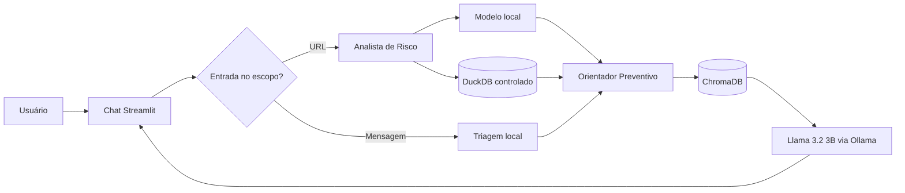

# Guardião Anti-Golpes Digitais

O Guardião é um assistente local que reúne orientação documental, consultas
estatísticas e triagem explicável de mensagens e URLs relacionadas a golpes
digitais.

## Objetivo

Ajudar pessoas a reconhecer sinais que merecem verificação, consultar ações
preventivas fundamentadas em documentos confiáveis e explorar padrões de um
conjunto estruturado de URLs. A aplicação comunica incertezas e não acessa os
endereços informados pelo usuário.

## Declaração do desafio

A motivação, a pergunta essencial e o desafio que orientaram o projeto estão
registrados na [Declaração CBL](docs/DECLARACAO_CBL.md).

## Funcionalidades

- Chat em Streamlit com histórico da sessão e orientação final em linguagem simples.
- Fluxo `Analista de Risco → Orientador Preventivo` com LLM local `llama3.2:3b` via Ollama.
- Classificador local persistido em `data/models/url_risk_model.joblib`, treinado com separação por domínio.
- RAG com três cartilhas do CERT.br, 44 chunks e índice ChromaDB.
- Fontes consultadas exibidas em painel recolhível, sem links externos clicáveis.
- Consulta estatística controlada a tabelas relacionadas no DuckDB.
- Triagem automática de mensagens, sinais textuais e URLs, sem abrir os endereços.
- Tracing opcional com Langfuse e avaliação com Golden Dataset/DeepEval.
- Recusa de perguntas fora do escopo documental.

## Arquitetura



As consultas estatísticas são associadas a SQLs previamente aprovados; o modelo
não recebe permissão para gerar ou executar SQL arbitrário. O Orientador consulta
as cartilhas locais antes de responder. Se o Ollama falhar ou produzir orientação
insegura, a aplicação mostra uma orientação local de contingência. Em todos os
casos, as URLs recebidas são tratadas apenas como texto e não são abertas.

## Pré-requisitos

- Windows com PowerShell.
- Python 3.11.
- [Ollama](https://ollama.com/) instalado e em execução.
- Conexão com a internet durante a primeira preparação do modelo de embeddings.

## Instalação

Clone o repositório e entre na pasta do projeto:

```powershell
git clone https://github.com/pedromanuelvincit/guardiao-anti-golpes.git
Set-Location guardiao-anti-golpes
```

Crie o ambiente e instale as dependências:

```powershell
py -3.11 -m venv .venv
& ".\.venv\Scripts\python.exe" -m pip install -r requirements.txt
ollama pull llama3.2:3b
```

Os valores padrão de configuração estão documentados em `.env.example`. Para
criar sua configuração local, copie o arquivo sem enviar o `.env` ao GitHub:

```powershell
Copy-Item ".\.env.example" ".\.env"
```

O projeto funciona sem chaves externas; o Langfuse é opcional. Se usar o
terminal integrado do VS Code, habilite `python.terminal.useEnvFile` para que
as variáveis do `.env` sejam injetadas em novos terminais.

### Observabilidade opcional (Sprint 3)

O tracing local usa Langfuse apenas quando `LANGFUSE_PUBLIC_KEY` e
`LANGFUSE_SECRET_KEY` estão definidas. `LANGFUSE_HOST` é opcional e assume
`https://cloud.langfuse.com`; sem as chaves ou sem a biblioteca instalada, o
fluxo permanece em modo no-op e não imprime segredos.

No PowerShell, configure somente na sessão atual (substitua os valores fora do
repositório):

```powershell
$env:LANGFUSE_PUBLIC_KEY = "pk-lf-..."
$env:LANGFUSE_SECRET_KEY = "sk-lf-..."
$env:LANGFUSE_HOST = "https://cloud.langfuse.com"
```

Valide sem integrar Streamlit:

```powershell
& ".\.venv\Scripts\python.exe" ".\scripts\test_observability.py"
```

O script informa `Tracing Langfuse: ativo` ou `inativo`, executa o workflow
RiskAnalyst → PreventiveAdvisor, preserva o fallback do Ollama e faz flush e
encerramento ao final. Nunca copie chaves para o README, logs ou commits.

### Golden Dataset e DeepEval (Sprint 3)

O arquivo `data/golden_dataset.json` contém exatamente 15 casos: 5 diretos,
4 em linguagem natural, 3 ambíguos/difíceis e 3 fora do escopo. A avaliação usa
somente o Ollama local como juiz, sem fallback para OpenAI:

```powershell
& ".\\.venv\\Scripts\\python.exe" -m pip install -r requirements.txt
& ".\\.venv\\Scripts\\python.exe" ".\\scripts\\test_deepeval.py" --structural-only
& ".\\.venv\\Scripts\\python.exe" ".\\scripts\\test_deepeval.py"
```

A avaliação completa requer o Ollama em execução e usa `OLLAMA_HOST` (padrão
`http://127.0.0.1:11434`) e `OLLAMA_MODEL` (padrão `llama3.2:3b`). Os três casos
fora do escopo são verificados como recusa e não entram nas métricas RAG. As
métricas `FaithfulnessMetric` e `AnswerRelevancyMetric` avaliam os 12 casos
relacionados às cartilhas.

## Preparação dos componentes

### 1. DuckDB

Os dois CSVs processados ficam em `data/processed` e se relacionam pela chave
`url_id`. Crie o banco local com:

```powershell
& ".\.venv\Scripts\python.exe" ".\scripts\build_duckdb.py"
```

O script cria `data/guardiao.duckdb`, valida a relação um para um e informa as
quantidades carregadas.

Para reproduzir também os CSVs, baixe o ZIP do dataset
[PhiUSIIL Phishing URL](https://archive.ics.uci.edu/dataset/967/phiusiil%2Bphishing%2Burl%2Bwebsite%2Bdataset)
para `data/raw/phiusiil.zip` e execute:

```powershell
& ".\.venv\Scripts\python.exe" ".\scripts\prepare_phiusiil.py" --input ".\data\raw\phiusiil.zip" --output-dir ".\data\processed"
& ".\.venv\Scripts\python.exe" ".\scripts\build_duckdb.py"
```

O preparo não visita as URLs do conjunto. Ele usa apenas o texto dos endereços,
remove duplicatas, redige valores de query e fragmento e neutraliza os campos
exibíveis.

### 2. ChromaDB

As três cartilhas ficam em `data/documents/raw`. Gere novamente os chunks e o
índice vetorial com:

```powershell
& ".\.venv\Scripts\python.exe" ".\scripts\prepare_rag.py"
```

Na primeira execução, a biblioteca baixa o modelo multilíngue de embeddings. O
aviso do Windows sobre suporte a links simbólicos não impede a indexação.

### 3. Classificador de risco (Sprint 1)

Treine e avalie o classificador local sem abrir nenhuma URL. Para persistir o
vencedor da validação, informe explicitamente um caminho de saída:

```powershell
& ".\.venv\Scripts\python.exe" ".\scripts\train_model.py" --model-output ".\data\models\url_risk_model.joblib"
```

O arquivo salvo contém o modelo escolhido, as 25 colunas numéricas esperadas
e o adaptador de entrada. O treinamento também compara limites de decisão na
validação, sem usar o teste para escolher o limite. A aplicação carrega esse
arquivo automaticamente;
para usar outro caminho, defina `GUARDIAO_MODEL_PATH`. O carregador apenas
analisa o texto da URL e não abre o endereço.

## Execução

Mantenha o Ollama aberto e inicie a interface:

```powershell
& ".\.venv\Scripts\python.exe" -m streamlit run ".\app.py"
```

O Streamlit exibirá o endereço local da aplicação no terminal.

## Perguntas para demonstração

### RAG documental

1. `Como conferir se um boleto é verdadeiro antes de pagar?`
2. `Como verificar se um áudio ou vídeo de alguém conhecido pode ter sido falsificado com inteligência artificial?`
3. `O que devo fazer depois de transferir dinheiro por Pix para um golpista?`

### Dados estruturados

1. `Quantas URLs são phishing e quantas são legítimas?`
2. `Qual é o comprimento médio das URLs e qual percentual usa HTTPS em cada classe?`

### Triagem

- `Analise esta mensagem: URGENTE: sua conta será bloqueada. Pague a taxa hoje em hxxp://198[.]51[.]100[.]45/verify`
- `Analise esta URL: hxxps://www[.]youtube[.]com/watch?v=abcdef12345`

Os endereços dos exemplos estão neutralizados para evitar cliques acidentais.

## Testes disponíveis

### Validações locais sem Ollama

```powershell
& ".\.venv\Scripts\python.exe" ".\scripts\test_input_analysis.py"
& ".\.venv\Scripts\python.exe" ".\scripts\test_duckdb_queries.py"
& ".\.venv\Scripts\python.exe" ".\scripts\test_url_model.py"
& ".\.venv\Scripts\python.exe" ".\scripts\test_sprint2_structure.py"
```

### Validações que usam Ollama ou componentes do RAG

Mantenha o Ollama em execução para os testes de workflow, observabilidade e
resposta baseada no modelo local:

```powershell
& ".\.venv\Scripts\python.exe" ".\scripts\test_rag_retrieval.py"
& ".\.venv\Scripts\python.exe" ".\scripts\test_rag_ollama.py"
& ".\.venv\Scripts\python.exe" ".\scripts\test_sprint2_workflow.py"
& ".\.venv\Scripts\python.exe" ".\scripts\test_observability.py"
```

### Avaliação DeepEval

O dataset contém exatamente 15 casos: 5 diretos, 4 em linguagem natural, 3
ambíguos/difíceis e 3 fora do escopo. Primeiro valide a estrutura e, depois,
execute a avaliação completa:

```powershell
& ".\.venv\Scripts\python.exe" ".\scripts\test_deepeval.py" --structural-only
& ".\.venv\Scripts\python.exe" ".\scripts\test_deepeval.py"
```

O teste `test_sprint2_structure.py` valida as tools locais e a passagem de
contexto. `test_sprint2_workflow.py` executa o fluxo RiskAnalyst →
PreventiveAdvisor, com Parecer Bruto, busca RAG e resposta final via tool
calling do Ollama. Sem Ollama, o workflow usa uma orientação local de
contingência. Os testes não abrem URLs nem integram serviços externos, exceto
as chamadas locais ao Ollama e o envio opcional de traces ao Langfuse.

## Dados e documentos

### Arquivos prontos para uso

- [Banco DuckDB](data/guardiao.duckdb)
- [Tabela de URLs](data/processed/urls.csv)
- [Tabela de atributos](data/processed/url_features.csv)
- [Índice ChromaDB](data/chroma/)

O DuckDB também pode ser reconstruído com o script scripts/build_duckdb.py.

### Dados estruturados

- **Fonte:** PhiUSIIL Phishing URL (Website), UCI Machine Learning Repository.
- **Autores:** Arvind Prasad e Shalini Chandra.
- **Licença:** CC BY 4.0.
- **Resultado processado:** 235.370 URLs únicas, sendo 134.850 legítimas e
  100.520 classificadas como phishing pela fonte.

### Documentos do RAG

Foram usados três fascículos da
[Cartilha de Segurança para Internet do CERT.br](https://cartilha.cert.br/fasciculos/):

1. *Golpes: Não se Deixe Enganar*.
2. *Golpes: Evite Fraudes*.
3. *Golpes: Caiu? Veja o que Fazer*.

Os documentos são disponibilizados pelo CERT.br/NIC.br sob
[CC BY-NC-ND 4.0](https://cartilha.cert.br/cc/).

## Segurança e limitações

- A aplicação não abre, resolve por DNS nem requisita URLs informadas pelo
  usuário ou presentes no dataset.
- A triagem identifica padrões textuais; ela não comprova que um endereço é
  seguro ou malicioso.
- O classificador local produz uma estimativa estatística baseada no dataset
  PhiUSIIL; o score não é reputação de domínio e não confirma fraude ou
  segurança.
- O RAG responde somente com base nas três cartilhas selecionadas.
- As consultas estruturadas cobrem intenções aprovadas para a demonstração e
  usam SQL read-only previamente definido.
- O dataset possui vieses de coleta. Por exemplo, muitos exemplos legítimos da
  amostra usam HTTPS; isso não torna HTTPS uma garantia de legitimidade.
- O projeto não substitui banco, polícia, advogado ou atendimento oficial.
- Sem credenciais do Langfuse, o tracing permanece desativado e a aplicação
  continua funcionando localmente.

## Estrutura principal

```text
app.py                              interface Streamlit
src/guardiao/                       workflow, agentes, tools e componentes locais
src/guardiao/agent_workflow.py      orquestração RiskAnalyst → PreventiveAdvisor
src/guardiao/url_model.py           carregamento e inferência do classificador
src/guardiao/observability.py       integração opcional com Langfuse
scripts/train_model.py              treinamento e avaliação do modelo local
scripts/build_duckdb.py             criação reproduzível do DuckDB
scripts/prepare_phiusiil.py         preparação segura dos CSVs
scripts/prepare_rag.py              extração, chunking e indexação
data/models/                        bundle do classificador persistido
data/processed/                     tabelas CSV processadas
data/documents/raw/                 três documentos do CERT.br
data/chroma/                        índice vetorial local
data/golden_dataset.json            15 casos para avaliação DeepEval
docs/                               decisões, validações e evidências
```

## Evidências de validação

- [Validação do RAG](docs/VALIDACAO_RAG.md)
- [Robustez do RAG](docs/VALIDACAO_ROBUSTEZ_RAG.md)
- [Validação do DuckDB](docs/VALIDACAO_DUCKDB.md)
- [Validação da triagem](docs/VALIDACAO_TRIAGEM.md)
