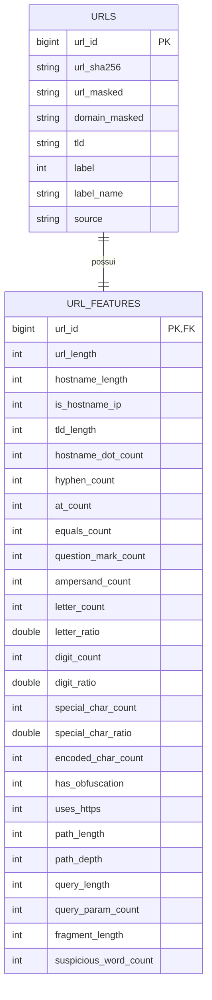

# Dados e esquema — Guardião Anti-Golpes Digitais

## 1. Requisito atendido

O enunciado exige pelo menos duas tabelas relacionadas, com dados relevantes, consultáveis em linguagem natural por meio do DuckDB ou tecnologia equivalente.

Esta microetapa produz os dois arquivos CSV e valida a relação entre eles. O carregamento no DuckDB será feito depois da configuração da aplicação.

## 2. Fonte escolhida

**Dataset:** PhiUSIIL Phishing URL (Website)

**Fonte oficial:** [UCI Machine Learning Repository](https://archive.ics.uci.edu/dataset/967/phiusiil%2Bphishing%2Burl%2Bwebsite%2Bdataset)

**Dados originais:** 235.795 linhas, 54 atributos, sem valores ausentes declarados.

**Rótulos:** `0` = phishing; `1` = legítima.

**Licença:** CC BY 4.0, com atribuição obrigatória.

**SHA-256 do ZIP inspecionado:** `0A639FD03AEA6308C5B1C10C92AA23C2CE1505447A9137271865CD0BADC9A59A`

## 3. Descobertas da inspeção

- O CSV real possui 56 colunas: `FILENAME`, `URL`, 53 atributos adicionais e `label`, totalizando 54 atributos de entrada conforme a contagem da UCI.
- Há 425 grupos de URL duplicada. Os rótulos são consistentes, mas alguns atributos variam entre cópias da mesma URL.
- Há 15.709 ocorrências adicionais de domínios repetidos, o que pode causar vazamento entre treino e teste.
- Colunas da página, como título, quantidade de linhas, formulários e scripts, exigiriam visitar o endereço e ficam fora do MVP seguro.
- Atributos estatísticos como `TLDLegitimateProb` e `URLCharProb` dependem do processo usado na criação da base e não são reproduzíveis diretamente para uma nova URL.
- No conjunto original, todos os exemplos legítimos usam HTTPS; todos os hosts identificados como IP estão rotulados como phishing. Esses padrões indicam viés de coleta e não devem ser apresentados como regras universais.

## 4. Decisão de preparação

1. Ler apenas `URL` e `label` do arquivo oficial.
2. Remover duplicatas exatas por URL, pois não existem conflitos de rótulo.
3. Recalcular todos os atributos usados pelo projeto diretamente do texto da URL.
4. Não acessar rede, DNS, certificado, HTML ou qualquer página.
5. Remover valores de query e fragmento antes de publicar a versão armazenada.
6. Neutralizar a URL armazenada, trocando `http` por `hxxp` e `.` por `[.]`.
7. Usar SHA-256 para rastreabilidade da URL original.

O resultado contém **235.370 URLs únicas**: 100.520 classificadas como phishing e 134.850 como legítimas.

## 5. Esquema relacional

### Tabela `urls`

| Campo | Função |
|---|---|
| `url_id` | Chave inteira gerada após deduplicação |
| `url_sha256` | Identificador estável da URL original |
| `url_masked` | URL neutralizada, com query e fragmento redigidos para exibição segura |
| `domain_masked` | Host neutralizado |
| `tld` | Último sufixo do host ou `sem_tld` |
| `label` | Rótulo original: 0 phishing, 1 legítima |
| `label_name` | Nome legível do rótulo |
| `source` | Atribuição à fonte |

### Tabela `url_features`

Todos os campos, exceto `url_id`, são características numéricas extraídas localmente. Elas descrevem comprimento, caracteres, partes da URL, codificação, protocolo e ocorrência de palavras suspeitas.

## 6. Validação executada

| Verificação | Resultado |
|---|---|
| Linhas em `urls.csv` | 235.370 |
| Linhas em `url_features.csv` | 235.370 |
| `url_id` único nas duas tabelas | Sim |
| Relação um para um | Sim |
| Células vazias após transformação | 0 |
| Rótulos fora de 0 e 1 | 0 |
| Tokens ativos `http://` ou `https://` em `url_masked` | 0 |
| Falhas ao interpretar o host | 0 |

## 7. Perfil inicial

| Classe | Registros | Comprimento médio | HTTPS | Média de dígitos |
|---|---:|---:|---:|---:|
| Legítima | 134.850 | 27,23 | 100,00% | 0,05 |
| Phishing | 100.520 | 46,22 | 48,63% | 4,34 |

Os 606 hosts representados como endereço IP estão na classe phishing. Isso descreve esta amostra e não constitui uma regra suficiente para classificar novas URLs.

## 8. Consultas candidatas para a demonstração

### Consulta 1 — distribuição das classes

**Pergunta:** Quantas URLs do conjunto são phishing e quantas são legítimas?

**Evidência esperada:** 100.520 phishing e 134.850 legítimas após deduplicação.

### Consulta 2 — comparação de características

**Pergunta:** Qual é o comprimento médio das URLs e qual percentual usa HTTPS em cada classe?

**Evidência esperada:** os valores devem corresponder ao perfil inicial desta documentação.

Uma terceira consulta poderá explorar hosts em formato de IP, desde que a resposta explique o viés do conjunto.

## 9. Critérios para o modelo futuro

- Usar somente atributos extraíveis sem abrir a URL.
- Separar treino, validação e teste por domínio, não por linha aleatória.
- Manter um baseline simples e explicável.
- Avaliar precisão, recall, F1, matriz de confusão e falsos negativos.
- Tratar a saída como estimativa de risco.
- Verificar desempenho em exemplos externos antes de qualquer alegação de utilidade real.
